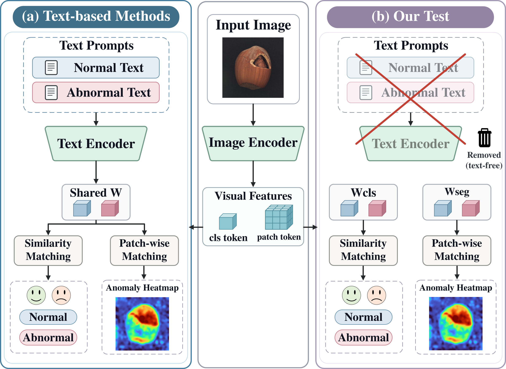
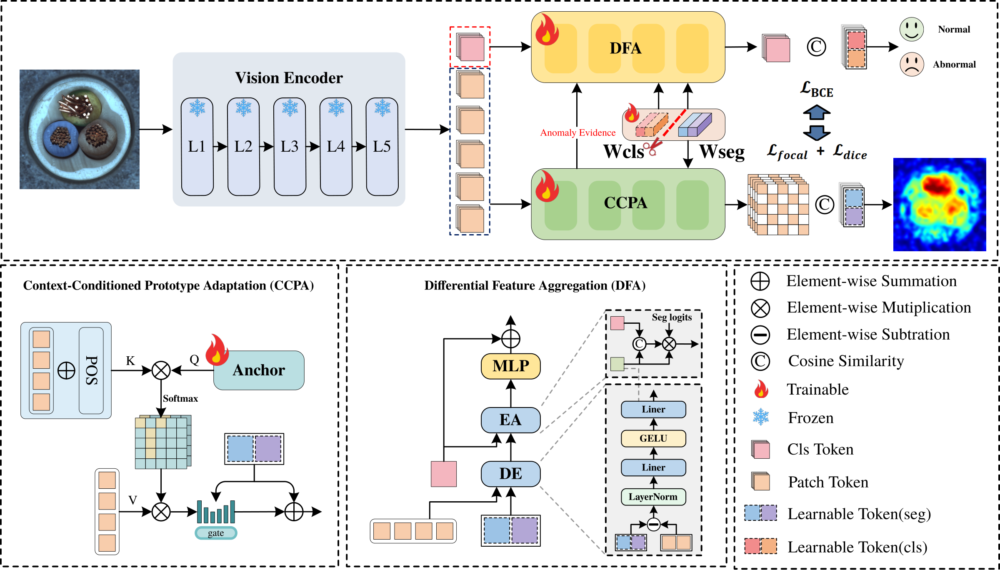

# DeVisualAD

> **DeVisualAD: A Decoupled Framework with Dynamic Visual Adaptation for Zero-Shot Anomaly Detection**, 2026.

## 📝 Introduction

DeVisualAD is a **visual-only** framework for zero-shot anomaly detection and localization. It learns task-specific normal and abnormal prototypes on a frozen visual encoder, supporting both **CLIP** and **DINOv3** without text prompts or a text encoder. Experiments cover 13 industrial and medical datasets.

  

- **Task decoupling:** independent classification and segmentation prototypes address the different distributions of global and local features.
- **Dynamic visual adaptation:** CCPA conditions segmentation prototypes on image context, while DFA aggregates local differential evidence to refine the global representation.
- **Scale augmentation:** GASA preserves a global image anchor while introducing contextual and local-scale variation during training.

## 💎 DeVisualAD Framework

  

## 📊 DeVisualAD with Different Foundation Models

| Backbone | Shot | MVTec-AD | VisA | Real-IAD |
| :--- | :---: | :---: | :---: | :---: |
| **CLIP** (ViT-L/14@336px) | 0 | 93.4 / 49.7 | 84.3 / 30.0 | 84.1 / 38.3 |
| **DINOv3** (ViT-L/16) | 0 | 93.5 / 54.3 | 86.1 / 34.6 | 85.4 / 41.9 |

> Results are **Image AUROC / Pixel AP (%)**, following the current manuscript. Zero-shot refers to the target categories. VisA is evaluated using a model trained on MVTec-AD; the other datasets use a model trained on VisA.

## 🏆 Comparison with State-of-the-Arts

| Method | MVTec-AD | VisA | Real-IAD |
| :--- | :---: | :---: | :---: |
| WinCLIP | 90.3 / 19.9 | 75.5 / 6.7 | 75.0 / 5.0 |
| APRIL-GAN | 86.1 / 38.9 | 77.5 / 25.7 | 74.1 / 30.6 |
| CLIP-AD | 90.2 / 34.4 | 82.5 / 25.9 | 77.4 / 29.4 |
| AnomalyCLIP | 91.8 / 33.6 | 81.5 / 20.6 | 77.3 / 24.9 |
| AdaCLIP | 92.1 / 42.1 | 79.7 / 29.2 | 83.0 / 35.0 |
| **DeVisualAD (CLIP)** | 93.4 / 49.7 | 84.3 / 30.0 | 84.1 / 38.3 |
| **DeVisualAD (DINOv3)** | 93.5 / 54.3 | 86.1 / 34.6 | 85.4 / 41.9 |

All entries report Image AUROC / Pixel AP (%) from the manuscript comparison tables.

## 📌 ToDo List

- [ ] Release training and testing code
- [ ] Release trained checkpoints
